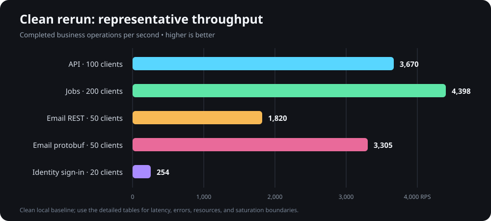
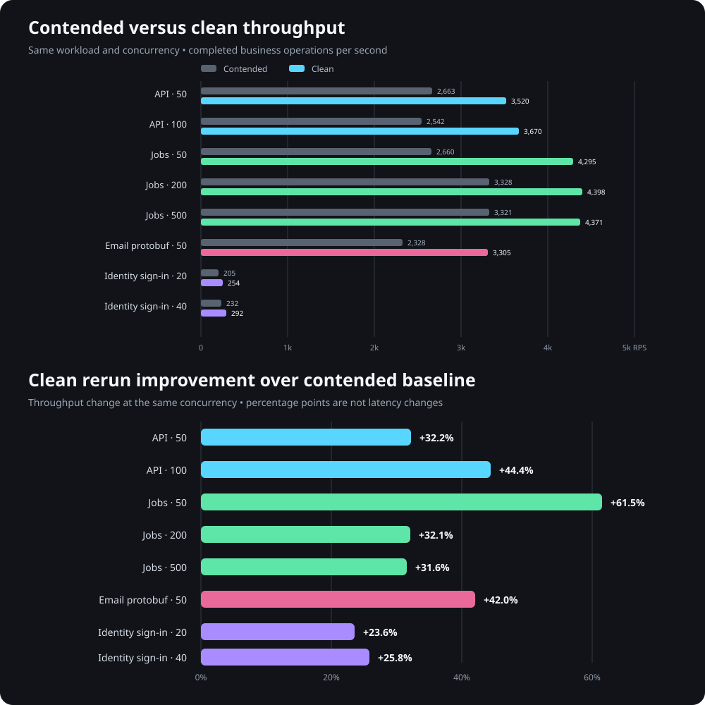

# Performance assessment - 2026-09-14

## Overall assessment

The measured performance is a strong baseline for a business-oriented .NET application. The primary API, Jobs API, Email queue-ingress API, and IdentityServer all demonstrated useful capacity with low tail latency at their recommended operating points. These measurements are not yet a production capacity guarantee because they use local infrastructure, selected endpoints, warmed processes, and controlled workloads.

## Service assessment

| Service and operating point | Result | Assessment |
| --- | --- | --- |
| Primary API, 50 clients | 3,519.75 RPS, 21.06 ms p95, 30.28 ms p99, zero errors | Excellent latency and throughput with substantial host CPU headroom. |
| Primary API, 100 clients | 3,670.18 RPS, 41.39 ms p95, 74.91 ms p99, zero errors | Highest useful measured API throughput and the observed performance knee. |
| Primary API, 200 clients | 2,410.44 RPS, 155.40 ms p95, 18 errors | Not a safe operating point under the current PostgreSQL connection budget. |
| Jobs API, 50-200 clients | 4,295-4,398 RPS, zero errors | Excellent throughput; 50 clients provides the best latency/capacity balance. |
| Email protobuf, 50 clients | 3,305 durable enqueues/second, 19.84 ms p95, zero errors | Excellent queue-ingress performance. It does not measure worker or SMTP delivery capacity. |
| IdentityServer, 20 clients | 253.97 successful sign-ins/second, 78.35 ms p95 | Strong password-verification capacity. Password hashing is intentionally CPU-intensive. |
| IdentityServer, 40 clients | 292.25 sign-ins/second, 163.50 ms p95, 80.67% host CPU | Diminishing throughput returns and approaching CPU saturation. |

## Capacity interpretation

The primary API consumed approximately 14% of total host CPU at its best measured point. The first API saturation boundary was PostgreSQL connection availability rather than application-host compute. At 200 clients, PostgreSQL returned SQLSTATE 53300 for 18 of 72,317 attempts. The API remained alive and completed the remaining 72,299 requests, demonstrating resilience to request-scoped database connection failures.

The 50-client clean API result means that 99% of 105,595 authenticated `GET /accounts/me` requests completed within 30.28 ms. Each result represents a complete local HTTPS request/response round trip through authentication, application handling, PostgreSQL access, serialization, and receipt by k6.

Protected-policy tests also produced no server errors. Excess traffic was rejected with HTTP 429 or gRPC `ResourceExhausted`, showing that the configured limiters contained single-principal floods without taking down the hosts.

## Supported capacity statement

The results support the following engineering statement:

> The application should comfortably support 200 normal interactive users per instance. Its currently validated latency-oriented envelope is approximately 50-100 simultaneously active business API requests and 10-20 simultaneous password operations. Sustained 200-request concurrency requires coordinated database connection-pool capacity and further mixed-workload validation.

“Two hundred users” and “two hundred continuously active requests” are different workloads. Human users normally spend most of their session reading or entering data, while the benchmark clients continuously issue requests without normal think time.

## Remaining validation

Production capacity should be finalized only after testing:

- a representative mix of reads, writes, larger responses, and complex queries;
- realistic network latency from a separate load-generator machine;
- a 10-30 minute soak and a controlled spike/recovery cycle;
- production-like database size, connection budgets, locks, and slow-query behavior;
- Email.Worker drain rate, retry behavior, SMTP/provider quotas, and queue-age objectives;
- login bursts, token refresh, garbage collection, thread-pool queueing, and multi-instance scaling.

The current measurements establish strong application performance and clear initial operating limits. They should be treated as regression baselines and capacity-planning inputs rather than service-level objectives.
