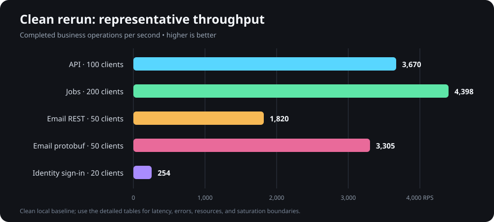
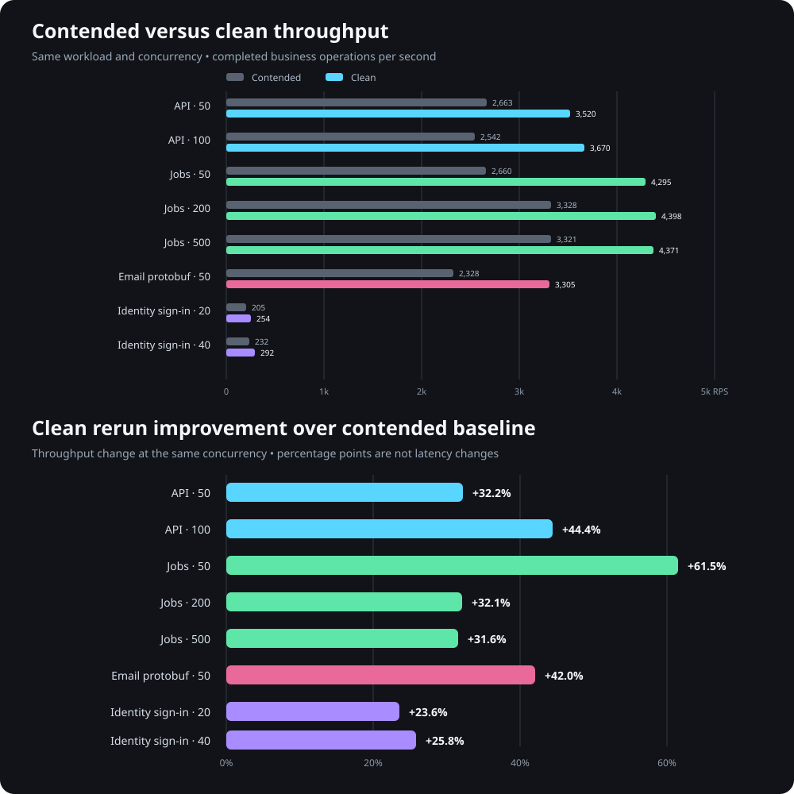

# Benchmark results - 2026-09-14 clean rerun

## Visual summary

These charts use comparable operating points. They do not imply that authentication, reads, and durable queue writes have equivalent cost or risk.

## Executive summary

This rerun replaces the contended workstation results for capacity planning. The original measurements remain preserved in `RESULTS-2026-09-14.md` as a noisy-neighbor baseline. Before this run, the workstation averaged 0.37% total CPU over a ten-second idle gate. The same Release builds, databases, endpoints, credentials model, isolated ports, and load shapes were used.

The clean rerun materially improves the measured ceilings:

- The primary API sustained 3,670 authenticated reads/second at 100 clients with 41 ms p95 and no errors. At 200 clients, PostgreSQL's connection boundary was reached and throughput fell to 2,410 requests/second.
- Jobs API sustained approximately 4,300-4,400 reads/second from 50 through 500 clients. Two hundred clients gave the highest measured throughput, but 50 clients produced much better latency for nearly the same capacity.
- Email protobuf gRPC sustained 3,305 enqueues/second at 50 clients, 42% above the first run and 82% above clean REST at the same concurrency.
- IdentityServer sustained 254 valid password sign-ins/second at 20 clients and 292/second at 40. The 40-client run used 81% total CPU and increased average latency sharply, so 20 remains the useful knee.
- All protected runs contained overload with HTTP 429 or gRPC `ResourceExhausted` and produced zero server errors.

## Why the PostgreSQL boundary is a good result

The 200-client primary API pass intentionally continued beyond the useful knee. PostgreSQL rejected 18 of 72,317 requests with SQLSTATE 53300 (`too many clients`), a 0.025% server-error rate. The API process did not crash, hang, or require a restart: it stayed alive and served the other 72,299 requests successfully.

That is a positive resilience and boundary-discovery result. It proves the application can drive the database to its configured connection ceiling and survive request-scoped connection failures. It also gives a concrete upper boundary for pool and limiter design. It is not a healthy production operating point: normal traffic should retain connection capacity for migrations, administration, health checks, recovery work, and other replicas. Production limiters and per-instance Npgsql pool budgets should shed or delay excess work before reaching PostgreSQL's reserved ceiling.

## Environment and method

- Machine: Intel Core i7-13700KF, 24 logical processors, 64 GB RAM, fast local storage.
- Runtime: .NET 10 Release builds on Windows.
- Generator: k6 2.2.0 on the same machine; no game or voice call was active during this rerun.
- Pre-run idle gate: 0.37% average total CPU over ten seconds.
- Databases: configured local PostgreSQL databases for command-q, IdentityServer, and Email; local SQL Server for Jobs.
- Topology: one measured host at a time, except IdentityServer remained available as the issuer during primary API tests.
- OpenTelemetry export was disabled. Host CPU and working set were sampled directly.
- Every host was warmed with a valid one-client smoke pass.
- Ceiling passes changed only the application limiter to disabled. Protected passes used the normal configured policy.
- API and Jobs tests were authenticated reads. Identity used successful password verification. Email measured queue insertion with the worker stopped.
- The primary API token was issued through the real SPA authorization-code with PKCE flow.

The local generator remained small relative to the system under test, but a separate generator is still required for publication-grade results and realistic network latency.

## Clean ceiling results

Latency is in milliseconds. RPS is completed business iterations per second over the full ramp profile.

| Service and route | Clients | Successful | RPS | Average | Median | p95 | p99 | Maximum | Errors |
| --- | ---: | ---: | ---: | ---: | ---: | ---: | ---: | ---: | ---: |
| API `GET /accounts/me` | 50 | 105,595 | 3,519.75 | 11.34 | 10.34 | 21.06 | 30.28 | 230.77 | 0 |
| API `GET /accounts/me` | 100 | 110,110 | 3,670.18 | 20.44 | 19.46 | 41.39 | 74.91 | 552.17 | 0 |
| API `GET /accounts/me` | 200 | 72,299 | 2,410.44 | 66.28 | 43.21 | 155.40 | 852.14 | 1,949.77 | 18 |
| Jobs `GET /jobs` | 50 | 214,827 | 4,295.07 | 9.14 | 9.66 | 13.07 | 14.92 | 159.92 | 0 |
| Jobs `GET /jobs` | 200 | 219,968 | 4,397.69 | 36.12 | 42.44 | 49.94 | 57.36 | 267.23 | 0 |
| Jobs `GET /jobs` | 500 | 218,643 | 4,371.18 | 91.31 | 111.06 | 127.90 | 138.60 | 266.35 | 0 |
| Email REST enqueue | 50 | 54,666 | 1,819.85 | 10.63 | 8.90 | 22.66 | 33.81 | 350.24 | 0 |
| Email REST enqueue | 200 | 57,985 | 1,930.29 | 39.07 | 35.02 | 86.32 | 127.28 | 733.29 | 0 |
| Email protobuf gRPC enqueue | 50 | 99,261 | 3,305.00 | 11.09 | 10.46 | 19.84 | 28.62 | 153.17 | 0 |
| IdentityServer valid sign-in | 20 | 7,620 | 253.97 | 65.94 | 67.77 | 78.35 | 95.82 | 226.84 | 0 |
| IdentityServer valid sign-in | 40 | 8,775 | 292.25 | 114.09 | 116.88 | 163.50 | 187.99 | 433.07 | 0 |

## Comparison with the contended run

| Workload | Contended RPS | Clean RPS | Change |
| --- | ---: | ---: | ---: |
| API, 50 clients | 2,662.58 | 3,519.75 | +32.2% |
| API, 100 clients | 2,542.15 | 3,670.18 | +44.4% |
| Jobs, 50 clients | 2,660.17 | 4,295.07 | +61.5% |
| Jobs, 200 clients | 3,328.33 | 4,397.69 | +32.1% |
| Jobs, 500 clients | 3,321.11 | 4,371.18 | +31.6% |
| Email protobuf, 50 clients | 2,328.10 | 3,305.00 | +42.0% |
| Identity sign-in, 20 clients | 205.43 | 253.97 | +23.6% |
| Identity sign-in, 40 clients | 232.37 | 292.25 | +25.8% |

The game and voice call materially depressed the first run. Keeping it is still valuable: it shows the services remained functional under substantial workstation contention, but the clean report is the appropriate basis for capacity estimates.

## Resource observations

CPU is the average share of all 24 logical processors during the pass. Memory is peak host working set.

| Service and clients | Host CPU | Peak memory | Interpretation |
| --- | ---: | ---: | --- |
| API, 50 | 14.28% | 170.2 MB | Healthy host headroom. |
| API, 100 | 14.10% | 187.4 MB | Best measured API throughput. |
| API, 200 | 10.41% | 241.5 MB | Database refusal and waiting reduce useful host work. |
| Jobs, 50 | 12.01% | 195.3 MB | Best latency/capacity balance. |
| Jobs, 200 | 14.88% | 211.4 MB | Highest measured Jobs throughput. |
| Jobs, 500 | 15.61% | 238.1 MB | More latency with no meaningful throughput gain. |
| Email REST, 50 | 6.84% | 171.8 MB | Database write path has large host headroom. |
| Email REST, 200 | 6.47% | 225.2 MB | More concurrency yields little throughput. |
| Email protobuf, 50 | 9.62% | 207.6 MB | Strongest Email transport result. |
| IdentityServer, 20 | 63.91% | 244.3 MB | Useful password-hashing knee. |
| IdentityServer, 40 | 80.67% | 240.8 MB | CPU saturation is approaching. |

## Protected-policy results

Every protected request used one identity or service principal. These passes validate abuse containment within one limiter partition, not aggregate capacity across many independent users.

| Service | Clients | Attempts | Admitted | Rejected | 5xx | Overall p95 | Host CPU |
| --- | ---: | ---: | ---: | ---: | ---: | ---: | ---: |
| API token bucket | 50 | 137,115 | 107 | 137,008 | 0 | 12.21 ms | 6.73% |
| Jobs protected policy | 200 | 139,320 | 441 | 138,879 | 0 | 65.07 ms | 5.62% |
| Email gRPC protected policy | 50 | 198,148 | 111 | 198,037 | 0 | 6.48 ms | 10.94% |
| Identity sign-in fixed window | 20 | 134,596 | 10 | 134,586 | 0 | 4.54 ms | 6.46% |

The API's admitted requests had a 4.03-second p95 under the flood; Jobs admitted requests had a 4.18-second p95. The queues protect throughput but create unpredictable latency for the few accepted calls. For ordinary API reads, reduce the queue to zero or a very small value and return 429 immediately. Keep a queue only where absorbing a short burst is explicitly more important than response-time predictability.

## Recommended initial operating envelope

- Primary API: use 50-100 concurrent virtual clients per instance as the measured latency-oriented range. Start capacity planning around 1,800-2,500 sustained authenticated reads/second per instance, leaving 30-50% headroom below the 3,670 RPS peak and well below the 200-client database boundary.
- Jobs API: use approximately 50-100 concurrent readers per instance. Plan initially around 2,200-3,000 sustained reads/second; 200 clients can reach about 4,400 RPS, but with materially higher latency.
- Email API: keep command-q on protobuf gRPC. With the current local database it sustained 3,305 enqueues/second at 50 clients. Use a much lower production ingress budget until worker drain rate, SMTP/provider quota, queue-age objectives, and storage growth are measured together.
- IdentityServer: plan around 10-20 simultaneous password operations and roughly 125-175 sustained successful sign-ins/second per instance. Keep the public authentication limiter far below the raw hashing ceiling for abuse protection.
- Coordinate Npgsql pool limits across all replicas. The sum of possible pools must remain below PostgreSQL's connection budget after reserving operational connections.

Before setting production service-level objectives, repeat a 10-30 minute mixed-route soak from a separate machine. Capture database active connections, pool waits, CPU, lock waits, slow queries, .NET allocation/GC, thread-pool queueing, Kestrel active requests, Email worker drain rate, and recovery after a spike.

## Cleanup and retained artifacts

- The Email worker stayed stopped. The clean rerun inserted 217,214 benchmark messages; a serializable transaction verified exact REST/gRPC counts and benchmark-only payload/status predicates, then deleted all 217,214 rows. Nothing was delivered to smtp4dev.
- Temporary PKCE files, bearer tokens, benchmark credentials, and cleanup utilities were removed.
- The generated local IdentityServer benchmark account and application profile remain; their generated credential was not retained.
- Raw k6 summaries, p99 metrics, resource samples, and logs remain ignored under `benchmarks/results`.
- No production or remote system was used.
