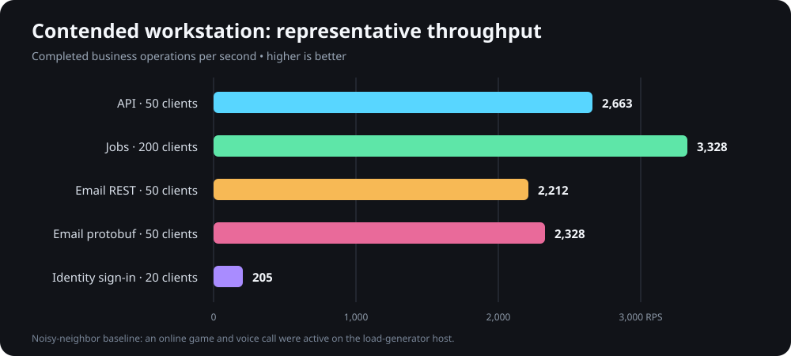

# Benchmark results - 2026-09-14 (contended workstation run)

This first report is intentionally preserved as the contended baseline. During these measurements, the workstation was also running an online game and a voice call, so CPU scheduling, network traffic, and storage activity were not isolated. Use the clean rerun for capacity decisions and this report only to understand behavior under noisy-neighbor pressure.

The replacement capacity report is `RESULTS-2026-09-14-CLEAN.md`.

## Visual summary

The bars compare representative operating points rather than every saturation step. IdentityServer is deliberately much lower because successful sign-in includes password-hash verification; it should not be compared as a lightweight read or queue operation.

## Executive summary

The services are ready for an initial dedicated-environment benchmark. These local results show healthy application-host headroom and identify the first practical limits:

- The primary API reaches its useful knee near 50 simultaneously active requests. At that point it sustained 2,663 requests/second at 28 ms p95 with no errors. At 100 clients, throughput declined to 2,542 requests/second and PostgreSQL rejected two connections.
- Jobs API scales to roughly 3,300 requests/second. Its useful range is 50-200 active requests; 500 clients added latency without increasing throughput.
- Email API sustained 2,212 REST enqueues/second and 2,328 protobuf gRPC enqueues/second at 50 clients. At 200 REST clients, PostgreSQL's connection limit was reached.
- IdentityServer sign-in is intentionally CPU-expensive because it verifies password hashes. Twenty active sign-ins sustained 205 requests/second at 90 ms p95. Doubling concurrency produced only 13% more throughput while increasing average latency by 76%.
- Every protected run rejected overload with HTTP 429 or gRPC `ResourceExhausted` and produced no server errors. The limiter queues can, however, make the small number of admitted requests wait about four seconds during a single-principal flood.

These are capacity baselines, not production service-level objectives. A conservative initial target is to keep steady load below the measured knee and preserve at least 30-50% headroom.

## Test environment and method

- Machine: Intel Core i7-13700KF, 24 logical processors, 64 GB RAM, fast local storage.
- Runtime: .NET 10 Release builds on Windows.
- Load generator: k6 2.2.0 on the same machine.
- Databases: the configured local PostgreSQL databases for command-q, IdentityServer, and Email; local SQL Server for Jobs.
- Topology: one system under test at a time, except that IdentityServer remained available while testing the primary API's authenticated route.
- Telemetry export was disabled to avoid measuring a missing or local collector. Process CPU and working set were sampled directly.
- The hosts were warmed with one-client smoke passes before ramp tests.
- Ceiling runs disabled only the application rate limiter. Protected runs used normal configured policies against the same build and data.
- The tested API and Jobs routes were authenticated reads. IdentityServer used a valid dedicated benchmark account. Email enqueue tests left the worker stopped so SMTP did not distort queue-ingress capacity.

Running k6 locally makes the load generator and service share hardware, so these results are deliberately treated as conservative regression baselines. k6 used less than 8% of total CPU in all sampled passes. Publication-grade results should repeat the suite from a separate load-generator machine with production-like database connection limits, latency, data volume, and TLS topology.

## Ceiling results

Latency values are milliseconds. RPS is completed iterations per second over the full ramp profile.

| Service and route | Active clients | Successful requests | RPS | Average | Median | p95 | Maximum | Server errors |
| --- | ---: | ---: | ---: | ---: | ---: | ---: | ---: | ---: |
| API `GET /accounts/me` | 50 | 79,884 | 2,662.58 | 14.97 | 12.79 | 27.94 | 2,971.12 | 0 |
| API `GET /accounts/me` | 100 | 78,688 | 2,542.15 | 31.74 | 16.71 | 42.54 | 13,509.98 | 2 |
| Jobs `GET /jobs` | 50 | 133,043 | 2,660.17 | 14.79 | 10.84 | 17.85 | 2,746.13 | 0 |
| Jobs `GET /jobs` | 200 | 166,462 | 3,328.33 | 47.76 | 52.37 | 69.91 | 779.60 | 0 |
| Jobs `GET /jobs` | 500 | 166,114 | 3,321.11 | 120.17 | 134.08 | 185.13 | 345.03 | 0 |
| Email REST enqueue | 50 | 66,404 | 2,212.36 | 16.95 | 14.32 | 28.78 | 4,086.34 | 0 |
| Email REST enqueue | 200 | 74,198 | 2,217.08 | 63.24 | 41.37 | 100.18 | 15,227.65 | 7 |
| Email protobuf gRPC enqueue | 50 | 69,944 | 2,328.10 | 16.05 | 13.42 | 30.03 | 2,373.87 | 0 |
| IdentityServer valid sign-in | 20 | 6,168 | 205.43 | 81.43 | 80.37 | 90.18 | 913.79 | 0 |
| IdentityServer valid sign-in | 40 | 6,974 | 232.37 | 143.67 | 143.23 | 203.81 | 2,774.64 | 0 |

The long maximum values are isolated tail events during ramp transitions or resource saturation; the median and p95 show the repeatable behavior. Future suite exports explicitly retain p99 as well as p95.

## Resource observations

CPU is the average share of all 24 logical processors during the run. Memory is peak process working set.

| Service and clients | Host CPU | Host peak memory | Interpretation |
| --- | ---: | ---: | --- |
| API, 50 | 11.18% | 163.0 MB | Database connections, not host compute, become limiting next. |
| Jobs, 50 | 8.42% | 178.0 MB | Large host headroom. |
| Jobs, 200 | 10.99% | 213.1 MB | Best measured throughput. |
| Jobs, 500 | 13.02% | 232.1 MB | No throughput gain; additional concurrency only adds waiting. |
| Email REST, 50 | 6.25% | 149.3 MB | Large host headroom. |
| Email gRPC, 50 | 7.00% | 165.0 MB | Approximately 5.2% more throughput than REST. |
| IdentityServer, 20 | 55.52% | 249.0 MB | Password hashing makes this path CPU-bound by design. |
| IdentityServer, 40 | 63.47% | 243.7 MB | Diminishing return and materially higher latency. |

The primary API and Email failures were PostgreSQL SQLSTATE 53300, indicating that the configured database client limit was exhausted. Increasing application concurrency without coordinating Npgsql pool sizes and PostgreSQL `max_connections` would move the failure rather than create useful capacity.

This is a positive overload-boundary result in one important sense: the benchmark drove the system far enough to find the configured database ceiling, and the application host stayed alive and responsive instead of collapsing. The individual requests that could not obtain a database connection failed cleanly and later protected runs produced only deliberate throttling responses. It is still not a desirable production operating point; limiter and pool budgets should reject or queue excess work before routine traffic reaches PostgreSQL's reserved connection boundary.

## Protected-policy results

Protected tests intentionally sent every request with one identity or service principal. They validate abuse containment for one partition; they do not represent total capacity across many independent users.

| Service | Clients | Total attempts | Admitted | Rejected | 5xx | Overall p95 |
| --- | ---: | ---: | ---: | ---: | ---: | ---: |
| API token bucket | 50 | 105,819 | 107 | 105,712 | 0 | 16.70 ms |
| Jobs protected policy | 200 | 322,951 | 442 | 322,509 | 0 | 32.60 ms |
| Email gRPC protected policy | 50 | 144,921 | 111 | 144,810 | 0 | 9.69 ms |
| IdentityServer sign-in fixed window | 20 | 103,410 | 10 | 103,400 | 0 | 6.74 ms |

The admitted API and Jobs calls waited as long as roughly four seconds during sustained overload because their limiter queues were full but enabled. For latency-sensitive reads, consider reducing the queue to zero or a very small value and returning 429 immediately. Keep queues only where short bursts are more important than response-time predictability.

## Recommended starting envelope

- API: target no more than about 50 simultaneously active database reads per instance until database connection budgets are measured and aligned. Treat roughly 1,300-1,800 RPS as a conservative initial steady envelope, then validate against a realistic route mix rather than extrapolating the 2,663 RPS single-route peak.
- Jobs API: use 50-100 simultaneously active reads per instance for a latency-oriented deployment. The host can reach roughly 3,300 RPS near 200 active requests, but p95 rises to 70 ms and additional clients do not help.
- Email API: keep queue-ingress concurrency near 50 or below per instance with the current PostgreSQL connection budget. Protobuf gRPC is the appropriate command-q transport and was modestly faster than REST.
- IdentityServer: budget approximately 10-20 simultaneous password operations per instance. Keep its strict per-IP sign-in limiter; authentication capacity should not be exposed as an unrestricted public throughput target.
- Use the limiter as overload protection, not as a substitute for database pool alignment. Configure total per-instance connection pools so the sum across replicas stays below each database's reserved connection budget.

Before committing production limits, repeat a 10-30 minute mixed-route soak from a separate generator and capture database CPU, active connections, pool waits, lock waits, .NET allocation/GC, thread-pool queueing, and Kestrel active requests. Then run a controlled spike and a recovery period to verify the service returns to baseline without a backlog.

## Test-side effects and discovered defect

- The Email worker remained stopped. The queue-ingress passes successfully inserted 212,331 benchmark outbox messages. After the runs, a serializable transaction verified the exact expected REST and gRPC counts plus benchmark-only status, lease, correlation, text, and subject predicates, then removed all 212,331 rows. No queued benchmark email was delivered to smtp4dev.
- A dedicated local IdentityServer benchmark account and corresponding application profile were created. No credential is stored in this report or in the repository.
- The temporary bearer-token file was removed after the API run. Raw ignored summaries and logs remain under `benchmarks/results` for local inspection.
- The initial Jobs smoke run exposed a real SQL Server persistence defect: its UTC Dapper type handler did not set `DbType.DateTime2`, causing `sql_variant` conversion failures. The handler was corrected and a focused regression test was added before Jobs measurements were recorded.
