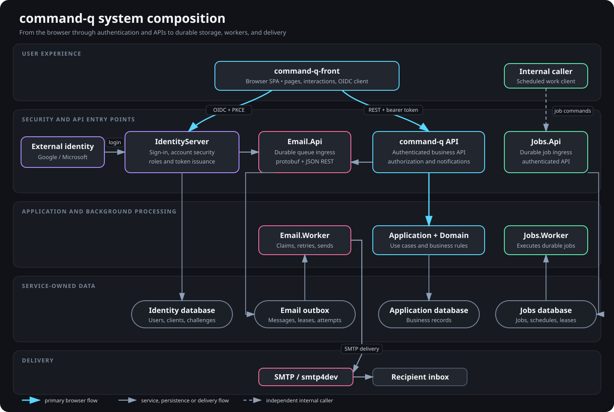

# command-q system composition

This overview shows how the user-facing application, authentication, business API, background services, and databases fit together. It intentionally stays above class-, endpoint-, and table-level detail.

## Typical user flow

1. A person uses the `command-q-front` single-page application in a browser.
2. The frontend redirects authentication work to IdentityServer using OpenID Connect with authorization code and PKCE. IdentityServer can authenticate a local account or delegate to a configured external identity provider.
3. The frontend calls the command-q API with the resulting access token. The API runs application and domain behavior and stores business data in the application database.
4. IdentityServer and command-q queue email through Email.Api. command-q uses the authenticated protobuf endpoint; Email.Api also retains a JSON REST surface for interoperable clients.
5. Email.Api durably writes messages to the email outbox. Email.Worker claims queued messages and sends them through the configured SMTP service, which is smtp4dev during local development.
6. Jobs.Api and Jobs.Worker provide the same API-plus-worker shape for durable background work. A caller uses that service only when it needs scheduled or asynchronous job execution.

## Ownership boundaries

- `command-q-front` owns browser presentation, interaction, and OIDC client behavior.
- IdentityServer owns credentials, account confirmation and recovery challenges, lockout, roles, external login links, and token issuance.
- The command-q API owns authenticated business operations and the application database boundary.
- Email.Api owns email queue ingress and outbox persistence; Email.Worker owns retries and SMTP delivery.
- Jobs.Api owns job ingress; Jobs.Worker owns execution of persisted background jobs.

Each host can be deployed and scaled independently. Their databases are shown separately because capacity, connection-pool, backup, and migration decisions belong to the service that owns the data.
